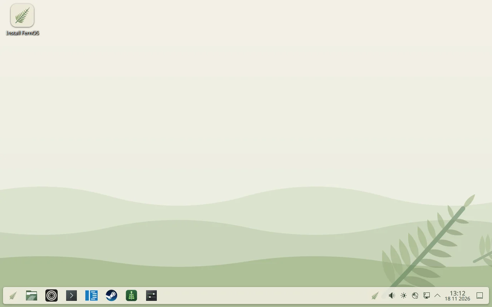

<p align="center"></p>

<h1 align="center">FernOS</h1>

<p align="center"><b>A calm desktop for coding, working and gaming.</b><br>
<a href="https://preston123451.github.io/FernOS/"><b>⬇ Download FernOS</b></a> ·
<a href="https://archive.org/details/fernos">Internet Archive</a></p>

<p align="center"></p>

## What is FernOS?

FernOS is a free Linux operating system that you can run on any 64-bit PC.
It's built on **Arch Linux** and **CachyOS** (a
fast kernel tuned for desktops) with the **KDE Plasma** desktop and a quiet
look: cream, beige and muted green. It works out of the box: everything below is
already installed.

* 🎮 **Game Mode**: one click in the panel gives you a performance CPU, Feral
  GameMode, desktop effects off and a night theme. **Steam, Lutris, Heroic,
  Discord and MangoHud** are included.
* 💼 **Work Mode**: a calm theme, a quieter CPU (power-saver on battery) and a
  built-in 25/5 focus timer. **Normal** puts your own theme back.
* 💻 **Ready to code**: VS Code (Code-OSS), Claude Code, git, Python, Rust,
  Node.js and C/C++ compilers. The **fish** shell has a FernOS tree welcome screen,
  `ls` with icons and an `update` shortcut.
* 🌐 **Zen Browser** is the default browser. **Fern** and **Fernblox** are preinstalled.
* 🟩 **NVIDIA driver included** for GTX 900/10-series up to RTX 40-series. It's
  removed automatically on PCs without an NVIDIA card.
* 🧭 **Easy graphical installer** that works offline, for UEFI and older BIOS PCs.

## Download and install

1. **[Download FernOS 0.2 (ISO, 3.9 GB)](https://archive.org/download/fernos/fernos-0.2-x86_64.iso)**, one file hosted by the
   Internet Archive. More info is on the [download page](https://preston123451.github.io/FernOS/).
2. *(Optional)* Check the download: its SHA-256 is
   `88995a5493603aa934736c4b586f9dfe0422dff027192b0440b1b915d6af85a9`.
3. Write `fernos-0.2-x86_64.iso` to a USB stick of 8 GB or more with
   [balenaEtcher](https://etcher.balena.io/), [Rufus](https://rufus.ie/) or KDE
   ISO Image Writer. This erases the USB stick.
4. Restart with the stick plugged in, open the boot menu (often **F11**, **F12**,
   **F8** or **Esc**) and choose the USB stick.
5. FernOS starts as a **live system**, so you can try it without changing your PC.
   To install, double-click **Install FernOS** on the desktop. Choosing *Erase disk*
   wipes the drive you pick, so back up first.

**Requirements:** 64-bit PC, 2 GB RAM (8 GB+ for gaming), 30 GB of disk space.

> **Status: 0.2, a hobby project in development.** It is tested in virtual machines
> (UEFI and BIOS install). See [docs/TESTING.md](docs/TESTING.md) and
> [docs/ROADMAP.md](docs/ROADMAP.md). Use it at your own risk.

---

## For developers: build it yourself

FernOS is built reproducibly with [archiso](https://wiki.archlinux.org/title/Archiso)
from Arch + CachyOS (generic x86-64) packages.


```sh
./scripts/check.sh        # static checks, no root needed
./scripts/build-iso.sh    # builds packages + ISO (asks for sudo for mkarchiso)
./scripts/test-vm.sh      # boot the ISO in QEMU/KVM (UEFI); --bios for legacy
```

Full instructions: [docs/BUILDING.md](docs/BUILDING.md).

## Repository layout

| Path | What it is |
|---|---|
| `iso/profile/` | archiso profile: package list, boot menus, live-session-only files (`airootfs/`) |
| `packages/` | FernOS's own pacman packages (PKGBUILDs), built into a local repo |
| `desktop/` | Desktop defaults installed by `fernos-desktop-settings` (Plasma, Konsole, SDDM, fish, presets) |
| `branding/` | Logo and wallpaper sources, generators, and rendered assets (`dist/`) |
| `scripts/` | Build, check and VM test tools |
| `docs/` | Architecture decisions, building, testing, troubleshooting, roadmap |
| `build/` | Build output (ignored by git) |
